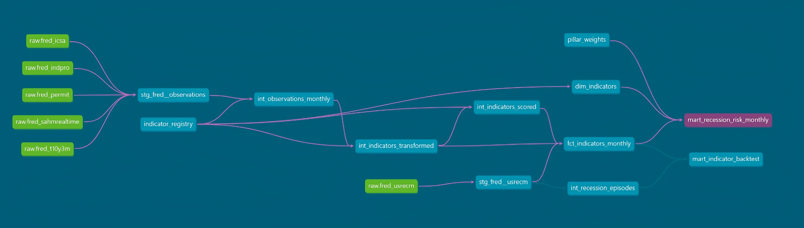

# US Macro Recession Risk Monitor

[](https://www.getdbt.com/)
[](https://duckdb.org/)
[](https://www.python.org/)
[](https://fred.stlouisfed.org/)

An end-to-end analytics engineering pipeline built with **dbt** and **DuckDB** that ingests multi-frequency macroeconomic indicators from the Federal Reserve Economic Data (FRED) API, and constructs individual indicator backtests plus a weighted composite index.

## 1. Architecture & Data Flow



### Medallion Layer Breakdown

- **Bronze (Staging):** Ingests raw CSVs, standardizes dates, and casts observation values. It also extracts NBER turning-point markers.
- **Silver (Intermediate):** 
  - Generates full calendar-month date spine to eliminate calendar gaps (`int_observations_monthly`).
  - Applies metadata-driven indicator transformations (`int_indicators_transformed`).
  - Implements bounded scoring and red-flag tagging (`int_indicators_scored`).
  - Isolates historical recession episodes, peak/trough dates, and durations (`int_recession_episodes`).
- **Gold (Marts):**
  - Dimensional star schema (`dim_indicators`, `fct_indicators_monthly`).
  - Composite index mart (`mart_recession_risk_monthly`).
  - Backtest evaluation mart (`mart_indicator_backtest`).

---

## 2. Monitored Indicators

All indicator specifications are maintained in `seeds/indicator_registry.csv`:

| Indicator | FRED Code | Pillar | Raw Freq | Monthly Agg | Transform | Safe Level | Risk Threshold | Economic Rationale |
|---|---|---|---|---|---|---:|---:|---|
| **10Y-3M Spread** | `T10Y3M` | Yield Curve | Daily | Average | Level | 1.00% | 0.00% | Yield curve inversion; persistent inversion signals monetary tightening and upcoming credit contraction. |
| **Sahm Rule** | `SAHMREALTIME` | Labor Market | Monthly | None | Level | 0.00% | 0.50% | Real-time unemployment momentum; increases of 0.50 pp above the 12-month low historically coincide with recession onset. |
| **Initial Jobless Claims** | `ICSA` | Labor Market | Weekly | Average | % Above 12M Min | 0.00% | 20.00% | High-frequency labor-demand proxy; surges > 20% over cyclical lows indicate accelerating layoffs. |
| **Industrial Production** | `INDPRO` | Real Activity | Monthly | None | YoY % | 2.00% | 0.00% | Broad physical output measure; negative annual growth reflects contraction in manufacturing. |
| **Building Permits** | `PERMIT` | Housing | Monthly | None | YoY % | 5.00% | -10.00% | Leading indicator of residential construction and consumer sentiment. |
| **Recession Flag** | `USRECM` | -- | Monthly | None | Boolean Flag | -- | -- | NBER-based recession chronology (1 = recession month from peak through trough). |


## 3. Analytical Methodology

### Monthly Frequency Alignment
Economic series publish on daily, weekly, or monthly cadences. Daily and weekly series are aggregated to monthly calendar means. Gaps are resolved via synthetic series spines (`generate_series`).

### Bounded Scoring (0 to 100)
Indicators are normalized using a bounded linear ramp-up function between an economically defined safe baseline (`safe_level`) and a critical warning threshold (`threshold`):

$$\text{score} = 100 \times \min\left[\max\left(\frac{x - \text{safe\_level}}{\text{threshold} - \text{safe\_level}}, 0\right), 1\right]$$

- **At or below `safe_level`:** The score is clamped to `0` (benign conditions).
- **At or beyond `threshold`:** The score reaches `100` (signal active, `is_red = true`).
- **Between both:** The score scales linearly between `0` and `100`, representing gradual risk accumulation.
- **Direction Invariance:** The formula naturally handles both positive risk indicators (higher indicates greater risk, e.g. Sahm Rule: `safe = 0.0`, `threshold = 0.5`) and inverse risk indicators (lower indicates greater risk, e.g. 10Y-3M Spread: `safe = 1.0`, `threshold = 0.0`).

### Pillar-Weighted Composite Risk
To prevent any one pillar from dominating the composite index (e.g. labor pillar contains two indicators vs only one in the other pillars), weights are assigned at the pillar level (25% each in `seeds/pillar_weights.csv`).

Because series have differing historical starts (e.g. `T10Y3M` begins in 1982, while `INDPRO` dates back to 1919), the composite score renormalizes active weights by dividing by the sum of available pillar weights each month.

### Backtesting Framework (`mart_indicator_backtest`)
Each indicator is evaluated against historical NBER recession episodes across an evaluation window spanning from 24 months prior to cycle peak through to 12 months after cycle peak:
- **Coverage (`window_covered`):** Requires the indicator to be actively scored on or before the start of the 24-month pre-peak window.
- **Signal Hit (`is_hit`):** Evaluates whether the indicator triggered a red flag (`score >= 100`) within the window.
- **Lead Time (`lead_months`):** The number of months between the initial red signal and the NBER peak (positive = early warning signal, negative = lagging warning signal).


## 4. Data Quality & Testing Strategy

Data integrity is tested continuously across staging, intermediate, and marts using dbt's native test suite and `dbt_utils`:

- **Primary & Composite Keys:** `unique` and `not_null` assertions on dimensions and staging tables; `dbt_utils.unique_combination_of_columns` across compound keys (`series_id, month` and `series_id, episode_id`).
- **Referential Integrity:** `relationships` tests enforcing foreign keys between marts, dimensions, and intermediate registries.
- **Value & Range Constraints:** `dbt_utils.accepted_range` verifying all normalized risk scores fall strictly within $[0, 100]$ and composite weights within $[0, 1]$.
- **Domain Assertions:** Singular business logic tests (e.g. `tests/indicator_safe_level_not_equal_to_threshold.sql` ensuring seeds contain valid ramp-up intervals without division-by-zero risk).


## 5. Repository Layout

```
rrm/
├── data/fred/                 # Cached raw indicator CSVs from FRED API
├── macros/                    # Reusable Jinja macros
│   ├── get_custom_schema.sql 
│   ├── get_sources_from_registry.sql
│   └── transform_observation.sql
├── models/
│   ├── staging/               # Bronze: raw source loading & casting
│   ├── intermediate/          # Silver: monthly spines, transforms, scoring, episodes
│   └── marts/                 # Gold: facts, dimensions, risk monitor, backtest
├── seeds/                     # indicator_registry.csv, pillar_weights.csv
├── tests/                     # Custom singular assertion tests
├── dbt_project.yml            # dbt project configurations
├── packages.yml               # packages: dbt_utils, codegen
├── profiles.yml               # DuckDB connection profile
├── script_extract_fred.py     # FRED extraction script
├── script_load_data.py        # DuckDB ingestion script
└── README.md                  # Project documentation
```

---

## 6. How to Run Locally

### Prerequisites
- Python 3.10+
- Virtual environment tool (`venv`)

### A. Environment Setup
```bash
# Navigate to the project root and create virtual environment
cd research/r1m1
python -m venv .venv

# Activate virtual environment
# Windows (PowerShell):
.\.venv\Scripts\Activate.ps1
# macOS / Linux:
source .venv/bin/activate

# Install dependencies
pip install -r requirements.txt
```

### B. Ingestion
The repository includes raw CSVs in `data/fred/` from a previous extraction run.

```bash
# Load CSV data into DuckDB (creates raw schema in dwh.ddb)
python script_load_data.py
```

> **(OPTIONAL) Refreshing data:** If you prefer to fetch more recent data, obtain a free API key from [St. Louis Fed FRED](https://fred.stlouisfed.org/docs/api/api_key.html), configure it in `.env`:
>```ini
>FRED_API_KEY=your_fred_api_key_here
>```
>And execute:
>```bash
>python script_extract_fred.py
>python script_load_data.py
>```

### C. Build & Test
Execute seeds, models, and tests:
```bash
# Install package dependencies
dbt deps

# Load seeds (indicator registry and pillar weights)
dbt seed

# Build models and run all data quality tests
dbt build
```

---

## 7. Caveats

- **Historical Sample Sizes:** Backtest evaluations cover between 4 and 17 recessions depending on each series inception (`T10Y3M` starts in 1982 and covers 4 recessions; `INDPRO` starts in 1919 and covers 17). Metrics provide descriptive information only, not sufficient for statistical inference.
- **Disclaimer:** *This is an analytical engineering project built for demonstration purposes only. It does not constitute financial, economic, or investment advice.*
